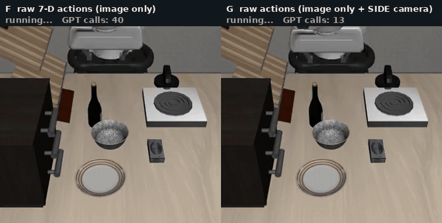

# Where Does a General Multimodal Model Break Down in Robot Manipulation?

**English** | [中文](README_zh.md)

A reproducible probe on the LIBERO simulator that separates what a general-purpose multimodal model can and cannot do when it controls a robot arm. The model under study is GPT-6 (`gpt-6-astra`, called through the Codex CLI); the harness works with any model that takes images and returns structured text.

📄 [Full report](docs/report.md) · 🎬 [All video cases](docs/cases.md) · 🛠 [Reproduce](code/README.md) · 📊 [Raw success counts](results/success_rates.csv)

## Research question

When a multimodal model controls a robot arm, which step limits it: deciding what to do, locating things in space, or producing the motor commands?

## Key results

Four pick-and-place tasks, 10 episodes each. In every row the model outputs 7-D end-effector delta actions, which go straight to the simulator's end-effector controller, bypassing any hand-written grasp/place routine. It always sees the main camera, the wrist camera and the end-effector position.

| What else the model is given | Success |
|---|:-:|
| Ground-truth object coordinates | **37/40** |
| Nothing else | **2/40** |
| One side-view camera image | **34/40** |
| Nothing else, but high reasoning effort (4 episodes per task) | 3/16 |

Same two cameras, images only; only the action interface changes:

| Interface | Success |
|---|:-:|
| Raw delta actions (the "Nothing else" row above) | 2/40 |
| Absolute end-effector target + measured-position feedback, ≤5 steps per call | 3/40 |
| … plus the last 3 main-camera frames | 11/40 |
| Galbot's GPT-as-Policy interface, ported to LIBERO (tasks 8 and 6) | **8/9** |

## Findings

**1. When object positions are known, can it complete the task?**
For pick-and-place and pressing, yes: given ground-truth object coordinates, it plans the grasp and produces workable actions on 7 of the 10 libero_goal tasks. It still fails at opening drawers and is unreliable at pushing.

**2. When object coordinates are removed, where does it fail?**
At depth along the main camera's line of sight. With the main and wrist cameras, the gripper closes on average 7.2 cm from the object on the camera side, while the average left-right offset stays under 1 cm. Letting a depth map convert its pixel choices into 3D recovers most tasks; asking it to state metric coordinates recovers none.

**3. What does adding a camera view fix, and what does it not?**
A side view perpendicular to the main camera removes most of the depth error, which a higher reasoning effort does not. It does not fix drawers, pushing, very small targets, or the habit of declaring success when a placement is 3–4 cm off.

**4. Is that depth failure the model's limit?**
Mostly not. Keeping the same two cameras and changing only the interface removes the depth bias: with absolute targets and measured-position feedback the depth error drops from 7.2 cm to 0.5 cm and the object is actually lifted in 20/40 episodes (28/40 with history frames) instead of 6/40, and Galbot's full interface ported to LIBERO succeeds 8/9. The remaining failures split between closing the gripper too high and misplacing a lifted object; most misplaced episodes end with the model declaring success. Code execution and reasoning effort do not explain the difference. Reported success rates from different groups (0% to 98%) are therefore not comparable without the harness.

## One case

Same scene, same model, no object coordinates. Left: main + wrist camera; the gripper closes on empty space in front of the bowl. Right: plus one side-view image; it grasps the rim and places the bowl on the stove.



## What was already known, and what this adds

| Already reported by others | Source |
|---|---|
| GPT-6 works as a zero-shot policy through end-effector targets; strong on coarse pick-and-place, weak on contact-rich insertion | Galbot, Robocurve |
| A VLA executing, with GPT-6 as planner or corrector, beats either alone on long-horizon tasks | Galbot (Hybrid), RPent |
| Metric coordinates from RGB are unreliable, and the model sometimes believes a grasp succeeded when it did not | FluxVLA issue #121 (single report) |
| One demonstration in context helps | GPT-Policy |

| New in this repository | Evidence |
|---|---|
| Planning, 2D pointing, 3D localization and control measured separately, against a ground-truth baseline | 40/40, 30/40, 0/40, 37/40; baseline 40/40 |
| The localization error is directional: 7.2 cm along the main camera's depth axis, under 1 cm sideways | [F] |
| Same model, same cameras: the action interface alone moves success from 2/40 to 8/9; code execution and reasoning effort are not the cause | [Q4](docs/report.md#q4-is-the-depth-failure-the-models-limit-or-the-interfaces) |
| Absolute targets with measured feedback fix the depth bias; false "done" is counted: 11 of 17 lifted-but-failed episodes end with the model declaring success | [H1], [H2] |
| Two open GPT-6 policy frameworks (GPT-as-Policy, GPT-Policy) run side by side on one benchmark | ports |

## Capability boundaries (within the tested tasks)

| Ability | Observed | Evidence |
|---|---|---|
| Choosing grasp part and placement from known coordinates | Reliable on 4 pick-place tasks | 40/40 |
| Delta-action control toward known targets (approach, grasp, carry, place, press) | Reliable | 37/40 on 4 tasks; 29/30 on 3 more |
| Pointing at objects in the image | Reliable, except when the image center of an opening differs from its 3D center | 30/40; 1/10 on the bowl-center task |
| Depth with the main + wrist cameras | Fails; biased toward the main camera | 2/40, 7.2 cm error |
| Depth with the same cameras, absolute targets + measured feedback | Depth bias gone (0.5 cm); grasping still fails in half the episodes (gripper closes too high), and misplaced objects are often declared done | 3/40; 11/40 with history frames; ported GPT-as-Policy interface 8/9 |
| Depth with an added orthogonal side view | Mostly works | 34/40, 1.6 cm error |
| Stating metric 3D coordinates from images | Fails | 0/40 |
| Approaching from the side (drawer handles) | Fails, with or without coordinates | 0/20, 0/20 |
| Non-prehensile pushing | Unreliable | 5/10 with coordinates |
| Anticipating implicit geometry (object offset when held by its rim) | Not without a hint; matters only for tight tolerances | 9/10 → 2/10 |

Scope: LIBERO simulation, 10 libero_goal tasks, 10 episodes per condition per task, lowest reasoning effort unless stated, one camera layout, one model. See [limitations](docs/report.md#limitations).

## Reproduce

```bash
cd code
export LIBERO_ROOT=/path/to/LIBERO PY=/path/to/venv/bin/python
source env.sh
bash run_condition.sh oracle 8 2               # checks the primitive controller, no model calls
bash run_condition.sh act_vision_side 1 10     # condition, task id, episodes
$PY analyze.py act_vision_side
```

Needs a GPU node for MuJoCo EGL rendering and a logged-in Codex CLI. [`code/conditions.tsv`](code/conditions.tsv) lists every condition, its arguments and the success counts reported here; see [`code/README.md`](code/README.md) for which configurations are historical and which are reconstructed.

## Related work

Galbot's *GPT 6 Astra as an Embodied Policy* reports 49/50 zero-shot on RoboLab pick-and-place with head and dual-wrist cameras; our images-only raw-action condition scores 2/40. We first attributed the gap to camera layout (adding a side view gives 34/40), but porting their interface to LIBERO with our two cameras gives 8/9, so the interface matters more than the cameras. See [Q4](docs/report.md#q4-is-the-depth-failure-the-models-limit-or-the-interfaces) and the [comparison](docs/report.md#comparison-with-related-work).

**Status.** One more condition ([H3]: the model can no longer end the episode itself) and topping the ports up to 10 episodes per task are scripted but not yet run; the Codex workspace spend cap was reached.
