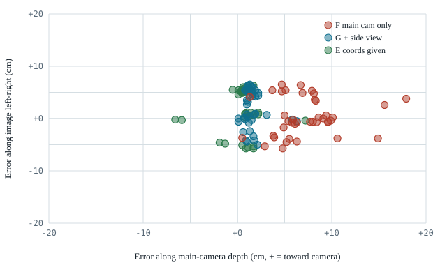
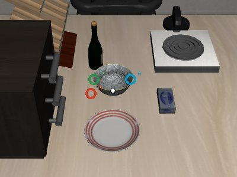

# Full Report

**English** | [中文](report_zh.md) · [← Back to overview](../README.md) · [Video cases](cases.md)

- [Setup](#setup)
- [Q1. When object positions are known, can it complete the task?](#q1-when-object-positions-are-known-can-it-complete-the-task)
- [Q2. When coordinates are removed, where does it fail?](#q2-when-coordinates-are-removed-where-does-it-fail)
- [Q3. What does adding a camera view fix, and what does it not?](#q3-what-does-adding-a-camera-view-fix-and-what-does-it-not)
- [Comparison with related work](#comparison-with-related-work)
- [Limitations](#limitations)

## Setup

**Environment.** LIBERO simulation, Franka Panda arm, libero_goal task suite. Success is judged by the simulator.

**Model.** `gpt-6-astra` via `codex exec`, lowest reasoning effort unless stated. Each call receives the current camera images, the instruction and a short history of its previous turns, and returns structured JSON. It is told not to run commands or read files.

**Cameras.** A fixed main camera looking at the table obliquely from the far side, and a wrist camera. One condition adds a side camera whose line of sight is perpendicular to the main camera's.

**Two interfaces.**

| Interface | What the model outputs | What executes it |
|---|---|---|
| Primitives | `grasp(target)`, `place(target)` or `done`; up to 6 calls per episode | A fixed controller moves the gripper vertically down to the target, closes/opens and lifts |
| Raw actions | Up to 10 steps of LIBERO's native action `[dx, dy, dz, droll, dpitch, dyaw, gripper]` in [−1, 1] per call; up to 40 calls / 450 steps | Submitted as-is to the simulator's built-in end-effector controller (LIBERO's default operational-space controller), bypassing the hand-written grasp/place routine. After each call the model gets new images, the measured end-effector displacement and position, and the gripper opening |

For raw actions, the prompt states the measured controller response: about 1.3 cm per step at full scale, about 1 cm of coasting after a stop, about 10 steps to close the gripper.

**Conditions.** Each condition changes one thing. The letter in brackets matches `results/success_rates.csv` and `code/conditions.tsv`.

| Condition | Interface | How targets are given | Model sees true object coordinates? |
|---|---|---|---|
| Ground-truth baseline (oracle) | Primitives | Computed from true positions | — |
| Primitives · coordinates [C] | Primitives | Metric xyz | Yes |
| Primitives · pixel [A] | Primitives | Pixel in the main image; a depth map converts it to 3D | No |
| Primitives · pixel, no hints [B] | Primitives | Same as above, without two hints about grasping bowls by the rim | No |
| Primitives · xyz from images [D] | Primitives | Metric xyz estimated from images | No |
| Raw actions · coordinates [E] | Raw actions | — | Yes |
| Raw actions · images only [F] | Raw actions | — | No |
| Raw actions · images + side view [G] | Raw actions | — | No |
| Raw actions · images only, high effort [F-high] | Raw actions | — | No |

"Images only" means no ground-truth object coordinates. Every raw-action condition still receives the main and wrist camera images and the measured end-effector position.

The two hints removed in [B] are: "the bowl is wider than the gripper, so grasp its rim" and "when holding the rim, the bowl's center is offset from the gripper, so compensate when placing".

**Tasks.** The core set is four pick-and-place tasks; Q1 and Q3 also use the other six libero_goal tasks.

| Task id | Instruction | Tolerance |
|---|---|---|
| 8 | Put the bowl on the plate | Strict: bowl center within 3 cm of plate center |
| 1 | Put the bowl on the stove | Loose |
| 4 | Put the bowl on top of the cabinet | Loose |
| 6 | Put the cream cheese in the bowl | Strict |
| 2, 9 | Put the wine bottle on the cabinet / rack | — |
| 7 | Turn on the stove (press a small knob) | — |
| 5 | Push the plate to the front of the stove | — |
| 0, 3 | Open the middle drawer / open the top drawer and put the bowl in | — |

**Episodes.** 10 per condition per task (9 for three tasks under [G], 4 for [F-high]). In total 413 GPT-6 episodes and 40 baseline episodes.

**Baseline.** Running the primitive controller on true object positions succeeds 40/40 on the four core tasks. This validates the primitive controller on those four tasks only: primitive-interface failures there come from the model's targets or decisions. It does not validate the raw-action interface or the other six tasks. For raw actions, the closest check is [E]: with object coordinates given, the same interface reaches 37/40 on the core tasks, so it is usable, but there is no model-free baseline for it.

---

## Q1. When object positions are known, can it complete the task?

### Core pick-and-place tasks

| Task | Primitives · coordinates [C] | Raw actions · coordinates [E] |
|---|:-:|:-:|
| 8 bowl→plate (strict) | 10/10 | 7/10 |
| 1 bowl→stove | 10/10 | 10/10 |
| 4 bowl→cabinet top | 10/10 | 10/10 |
| 6 cheese→bowl (strict) | 10/10 | 10/10 |
| **Total** | **40/40** | **37/40** |

With primitives, given only object *origins*, the model works out the rest itself: the bowl must be grasped by its left or right rim (about 5 cm from center and 4 cm up), and the placement point must be offset to compensate. After a missed grasp on task 6 (all 10 first grasps were 1.5 cm too high), it reads "gripper closed on nothing" from the feedback and retries lower, succeeding every time.

With raw actions, it produces the full sequence itself: approach, slow down, align with the rim, descend, close, lift, carry, lower, release. Episodes take 11–14 calls and 100–130 steps, fewer than the fixed primitive controller (180–225 steps). All three failures are on task 8: the bowl is on the plate but 5.5 cm from its center, and the model declares success.

### Other task types

| Task | Type | Raw actions · coordinates [E] |
|---|---|:-:|
| 2 wine bottle→cabinet top | Pick-place, slender object | 10/10 |
| 9 wine bottle→rack | Pick-place, slender object | 9/10 |
| 7 turn on stove | Press a small knob | 10/10 |
| 5 push plate | Non-prehensile push | 5/10 |
| 0 open middle drawer | Articulated | 0/10 |
| 3 open top drawer, put bowl in | Articulated, two stages | 0/10 |
| **All 10 tasks** | | **71/100** |

- Pick-place and pressing carry over (29/30). The wine-bottle tasks take 8–9 calls and 70–85 steps.
- **Drawers fail regardless of localization.** The gripper stays pointing down. It descends from above the cabinet, hits the cabinet body, lifts, shifts and descends again until its calls run out. It never reaches the handle, and no drawer moves in any episode. Reaching a front-facing handle requires approaching from the side or rotating the wrist, which it never tries. The prompt says "keep rotations at 0 unless you need to rotate", which may discourage this. Caveat: the simulator has no named handle, so the coordinates given here are the drawer body's center, not the handle's.
- **Pushing is unreliable.** In failed episodes the plate moves but does not reach the target region.

**Answer.** Within free-space pick, place and press, knowing where objects are is enough: the model plans the grasp and generates workable motor commands. Tasks that need a planned approach direction or sustained contact are not solved even with coordinates.

---

## Q2. When coordinates are removed, where does it fail?

### Raw actions from images

| Task | Raw actions · coordinates [E] | Raw actions · images only [F] |
|---|:-:|:-:|
| 8 bowl→plate | 7/10 | 0/10 |
| 1 bowl→stove | 10/10 | 0/10 |
| 4 bowl→cabinet top | 10/10 | 1/10 |
| 6 cheese→bowl | 10/10 | 1/10 |
| **Total** | **37/40** | **2/40** |

In most [F] episodes the object is never touched (median final displacement 0 cm), and nearly all use the full 40 calls.

**The error has a direction.** At the first gripper close of each episode, we measure the gripper's horizontal offset from the object, split into the component along the main camera's line of sight and the component along the image's left-right axis:

| Error at first gripper close | Along camera depth | Along image left-right |
|---|:-:|:-:|
| Raw actions · images only [F] | 7.2 cm (toward camera) | 0.3 cm |
| Raw actions · coordinates [E] | 0.6 cm | 2.0 cm |

*[E]'s left-right spread on the bowl tasks is two deliberate clusters at ±5 cm: it grasps the left or right rim.*

The model aligns the gripper with the object in the image plane but cannot tell whether it is directly above the object or hovering 7 cm in front of it. From the oblique main camera the two views are nearly identical, and in practice the wrist camera, which is also in the input, does not resolve it. Its own scene descriptions say things like "the gripper is directly above the cream cheese" when it is 8 cm away. Getting a fresh image every 10 steps does not help, because every new image has the same ambiguity.

### The same failure through other interfaces

Keeping the primitive controller and only changing how targets are expressed:

| Task | Primitives · pixel [A] | Primitives · xyz from images [D] | Primitives · coordinates [C] |
|---|:-:|:-:|:-:|
| 8 bowl→plate | 9/10 | 0/10 | 10/10 |
| 1 bowl→stove | 10/10 | 0/10 | 10/10 |
| 4 bowl→cabinet top | 10/10 | 0/10 | 10/10 |
| 6 cheese→bowl | 1/10 | 0/10 | 10/10 |
| **Total** | **30/40** | **0/40** | **40/40** |

- **Stating metric coordinates from images fails completely [D].** All 40 first grasps miss; its bowl-position estimates are 8–25 cm off and change on every retry; objects end 14–27 cm from their targets. On the first step of task 8, [C] and [D] give word-for-word the same reasoning ("grasp the left rim of the bowl so it can be lifted onto the plate"). [C]'s target is on the rim; [D]'s is on the table 8 cm away.

*First grasp target on task 8. White: true bowl center. Blue: [A]'s pixel (right rim). Green: [C]'s coordinates (left rim). Red: [D]'s coordinates (table, 8 cm off).*

- **Pointing at pixels works [A],** because the depth map converts the pixel to 3D and supplies exactly the missing depth. This is consistent with the directional error above: left-right localization in the image is good.
- **One exception shows the same blind spot.** On task 6 [A] scores 1/10. The model points at the center of the bowl's opening *in the image*. Because the camera is oblique, that line of sight passes through the opening and hits the far inner wall, so the 3D point lands about 3.5 cm beyond the true center and the cheese ends up on the rim. It points at the same pixel on every retry. With metric feedback [C] it corrects itself; with pixel feedback it does not.

### Implicit geometry needs a hint

Removing the two bowl-rim hints [B] makes no difference on the loose tasks (10/10 on tasks 1 and 4) but drops task 8 from 9/10 to 2/10. On its first placement it aims the gripper at the plate center (0.5 cm off on average) without compensating for the ~5 cm offset of a bowl held by its rim. With only 10 episodes per cell, this estimate is noisy: the same condition scored 6/10 under an earlier controller version.

| Task | Primitives · pixel [A] | Primitives · pixel, no hints [B] |
|---|:-:|:-:|
| 8 bowl→plate (strict) | 9/10 | 2/10 |
| 1 bowl→stove | 10/10 | 10/10 |
| 4 bowl→cabinet top | 10/10 | 10/10 |
| 6 cheese→bowl (strict) | 1/10 | 1/10 |

**Answer.** Without object coordinates, in this main + wrist camera setup, the dominant failure is depth along the main camera's line of sight. Left-right localization, planning and control remain usable, as shown by pixel pointing with a depth map (30/40) and by raw actions with coordinates (37/40).

---

## Q3. What does adding a camera view fix, and what does it not?

### Core tasks

Two single-change variants of raw actions · images only [F]:

| Task | Images only [F] | Images only, high effort [F-high] | Images + side view [G] | Reference: coordinates [E] |
|---|:-:|:-:|:-:|:-:|
| 8 bowl→plate (strict) | 0/10 | 0/4 | 5/10 | 7/10 |
| 1 bowl→stove | 0/10 | 1/4 | 10/10 | 10/10 |
| 4 bowl→cabinet top | 1/10 | 0/4 | 10/10 | 10/10 |
| 6 cheese→bowl (strict) | 1/10 | 2/4 | 9/10 | 10/10 |
| **Total** | **2/40 (5%)** | **3/16 (19%)** | **34/40 (85%)** | **37/40 (93%)** |

| Error at first gripper close | Along camera depth | Along image left-right |
|---|:-:|:-:|
| Images only [F] | 7.2 cm | 0.3 cm |
| Images only, high effort [F-high] | 3.5 cm | 2.0 cm |
| Images + side view [G] | **1.6 cm** | 1.9 cm |
| Coordinates [E] | 0.6 cm | 2.0 cm |

- **A side view removes most of the depth error.** The side camera sees the main camera's depth axis as left-right. Success goes from 5% to 85%, close to the 93% achieved with true coordinates, without ground-truth object coordinates or depth maps (the end-effector position is still provided, as in every raw-action condition).
- **More reasoning helps less.** High effort halves the depth error but leaves 3.5 cm, and reasoning tokens per call rise from about 80 to about 210. With only 16 episodes, we can say it is far less effective than a second view, not how effective it is.
- **Remaining failures are about finishing, not finding.** 4 of [G]'s 5 failures on task 8 leave the bowl on the plate 3.2–4.1 cm from center (threshold 3 cm) and declare success, the same pattern as [E]'s failures. The model does not check whether the success condition is actually met.

### Other task types

| Task | Coordinates [E] | Images + side view [G] |
|---|:-:|:-:|
| 2 wine bottle→cabinet top | 10/10 | 8/10 |
| 9 wine bottle→rack | 9/10 | 7/10 |
| 7 turn on stove (small knob) | 10/10 | 4/10 |
| 5 push plate | 5/10 | 0/9 |
| 0 open middle drawer | 0/10 | 0/9 |
| 3 open top drawer, put bowl in | 0/10 | 0/9 |
| **All 10 tasks** | **71/100** | **53/97** |

- Pick-place on slender objects mostly transfers (15/20).
- Small targets suffer: the stove knob drops from 10/10 to 4/10, with the gripper landing next to it.
- Drawers and pushing, which already failed with coordinates, stay failed.

**Answer.** A second, orthogonal view fixes the depth problem for pick-and-place of normal-sized objects. It does not fix precision on very small targets, tasks that need a planned approach direction or contact control, or the habit of declaring success without checking.

---

## Q4. Is the depth failure the model's limit or the interface's?

Two open-source GPT-6 policy frameworks use the same camera pair as this probe: one main camera plus a wrist camera. If they succeed in our environment, the failure of [F] cannot be blamed on the cameras.

**Ports.** We connected GPT-as-Policy (Galbot) and GPT-Policy (arXiv:2609.19138) to the same LIBERO setup. The model-facing side (prompt, tool schema, action validation, conversation handling) is their code; the simulator side is ours. Cameras match [F]: no side view, no depth map, no object coordinates. The adapters are not in this repository yet (upstream licensing not checked).

**Moving our interface toward theirs, one change at a time.** Images only, main + wrist camera, a fresh conversation per call, lowest effort, 10 episodes per task, up to 90 calls.

| Condition | Change relative to [F] |
|---|---|
| [F-wrist] | The prompt tells the model to use the wrist camera to check that the target sits between the fingers |
| [H1] | Output an absolute end-effector target (rejected if more than 5 cm from the measured position); 1–5 steps per call; the measured position and the remaining error are fed back |
| [H2] | [H1] plus the main-camera frames from the previous 3 calls |

| Interface (same two cameras, images only) | Task 8 | Task 1 | Task 4 | Task 6 | Total |
|---|:-:|:-:|:-:|:-:|:-:|
| [F] raw delta actions | 0/10 | 0/10 | 1/10 | 1/10 | 2/40 |
| [F-wrist] | 0/10 | 0/10 | 0/10 | 1/10 | 1/40 |
| [H1] absolute target + feedback | 0/10 | 0/10 | 2/10 | 1/10 | 3/40 |
| [H2] [H1] + history frames | 1/10 | 2/10 | 6/10 | 2/10 | 11/40 |
| GPT-as-Policy, ported (low 3/4 + xhigh 3/3 on task 8) | 6/7 | — | — | 2/2 | 8/9 |
| GPT-Policy, ported, no demonstration | 4/5 | — | — | — | 4/5 |
| [G] side view, for reference | 5/10 | 10/10 | 10/10 | 9/10 | 34/40 |

| Stage metric | [F] | [H1] | [H2] |
|---|:-:|:-:|:-:|
| Depth error at first gripper close (mean) | 7.2 cm toward the camera | 0.5 cm | 0.7 cm |
| Episodes in which the object was lifted | few | 40/40 | 38/40 |
| Failed episodes: first release point to target center (median) | — | 17.5 cm | 16.8 cm |
| Failed episodes that the model declared complete | — | 11/37 | 12/29 |

- **The cameras were not the limiting factor.** With the same cameras, the two ports succeed 10/12 on task 8, where [F] scores 0/10. A side view is one fix, not the only one. This revises the Q3 reading that camera layout is the main reason for the gap to Galbot.
- **Prompt wording is not the cause.** [F-wrist] scores 1/40.
- **Absolute targets with measured feedback remove the depth error** (7.2 → 0.5 cm), and every [H1] episode grasps the object. The model approaches step by step, reading the measured position.
- **The bottleneck moves to placement.** Failed episodes release the object about 17 cm from the target (median), and about a third of them end with the model declaring success, for example describing the cream cheese as "inside the bowl" while it sits on the table 15 cm away. This is the execution-state hallucination reported in FluxVLA issue #121, here counted.
- **History frames help but do not close the gap** (3 → 11 of 40). Remaining differences from the ports: episodes end only when the simulator confirms success (the model cannot declare completion); one persistent conversation; their prompt; 384 vs. 512 px images; joint-position vs. end-effector control. [H3], which is [H2] with the model's completion flag ignored, is scripted (`code/slurm/round7_nodone.sbatch`) but not yet run.
- **Code execution and reasoning effort do not explain the ports' success.** A GPT-as-Policy episode with the shell unavailable succeeded; when the shell was available the model only read files and took notes. xhigh scored 4/4 and low 4/5.
- **A demonstration from another task did not mislead GPT-Policy.** With a bowl→stove demonstration on the bowl→plate task it scored 5/5; its notes show it reused only the rim grasp. One kind of wrong demonstration, 5 episodes.

**Answer.** Mostly the interface. With the same model and the same cameras, task 8 ranges from 0/10 to 6/7 depending on the action interface and the feedback it returns. Success rates from different groups are not comparable without their harness.

---

## Comparison with related work

### Galbot, *GPT 6 Astra as an Embodied Policy*

They also call GPT-6 Astra through Codex, but at xhigh effort and with file reading, code execution and note-taking allowed. Inputs are head and dual-wrist RGB, joint and end-effector state, instruction and history, without ground-truth object coordinates. Direct mode outputs dual-arm end-effector target poses, executing 1–5 steps per call through inverse kinematics. Hybrid mode has π0.5 propose 50 steps; GPT-6 keeps the first 1–15 or supplies 1–5 corrective steps.

| Their finding | Numbers |
|---|---|
| Direct mode works zero-shot on semantic pick-place | RoboLab (single arm) 49/50; RoboDojo (bimanual, long-horizon) 26% |
| Long-horizon bimanual: Hybrid > Direct > π0.5 alone | 48% / 26% / 15.67%; GPT edits 14.4% of control steps; 44.8% fewer tokens |
| Hybrid is slightly worse when the VLA isn't fine-tuned on the task | RoboLab: Direct 98%, Hybrid 92%, π0.5 36% |
| Failure modes include repeated failed grasps, container-edge collisions, difficulty turning proprioceptive state into reachable targets | Qualitative |
| Attribution to individual factors left for future work | — |

What this probe adds:

| Finding | Evidence |
|---|---|
| Separate measurements of target selection, 2D pointing, 3D localization and control, with a ground-truth baseline | [C] 40/40, [A] 30/40, [D] 0/40, [E] 37/40, [F] 2/40, baseline 40/40 |
| Localization error is directional (camera depth 7.2 cm vs. left-right 0.3 cm) and largely fixed by one orthogonal view (5% → 85%), much more than by higher effort (19%) | [F], [G], [F-high] |
| Stating metric coordinates from images is unusable | [D] 0/40 |
| Image center ≠ 3D center under an oblique view; metric feedback allows correction, pixel feedback does not | Task 6: [A] 1/10, [C] 10/10 |
| Drawer failures persist with coordinates, i.e. they are not a localization problem; this matches their "container-edge collision" and "unreachable target" failure modes | Tasks 0, 3: [E] and [G] 0 |
| Same model and cameras: the interface alone moves task 8 from 0/10 to 6/7; code execution and effort are not the cause | [Q4](#q4-is-the-depth-failure-the-models-limit-or-the-interfaces) |
| Absolute targets with measured feedback fix depth (7.2 → 0.5 cm) and expose false completion in about a third of failed episodes | [H1], [H2] |
| Two open GPT-6 policy frameworks run side by side on one benchmark | Q4 ports |

**The apparent contradiction.** Their images-only Direct mode scores 49/50 on RoboLab pick-place; our [F] scores 2/40. An orthogonal side view takes [F] to 34/40, but [Q4](#q4-is-the-depth-failure-the-models-limit-or-the-interfaces) shows the extra camera is not required: with our main + wrist cameras, their interface ported to LIBERO scores 8/9. The gap therefore comes mainly from the interface (absolute targets with measured feedback, short chunks, a persistent conversation, simulator-only termination), not from camera layout, reasoning effort or tool use.

### FluxVLA issue #121

This issue reports the same pattern as Q2: manipulation succeeds through planning and 2D image understanding, while metric 3D coordinates are unusable. This probe reproduces it over 4 tasks and 40 episodes ([D] 0/40) and narrows it to the depth axis of the camera.

---

## Limitations

- **Sample size.** 10 episodes per condition per task. Gaps like 0/40 vs. 40/40 are reliable; single cells in the prompt-hint comparison are not (task 8 without hints scored 6/10 and 2/10 under two controller versions).
- **Task coverage.** The primitive interface was tested only on the four core pick-place tasks.
- **Drawer coordinates.** The drawer tasks give the drawer body's center, not the handle, so "coordinates given" is weaker there.
- **Codex wrapper.** Every call includes Codex's own system prompt (about 13k tokens), so results may differ from the bare model through the API.
- **Reasoning effort.** Lowest effort everywhere except [F-high], which has only 4 episodes per task.
- **Camera layout.** The 7.2 cm depth error is specific to this main-camera placement.
- **No model comparison.** Without previous GPT versions or open-source models, we cannot say which of these abilities are new to GPT-6.
- **Visible reasoning.** Even with high effort and detailed summaries, Codex returns only one or two reasoning headings, so failures are diagnosed from actions and stated rationales, not from the chain of thought.
- **Success criterion.** LIBERO's native check (contact and within 3 cm) can fire while the object is still held, ending the episode. All successes in the raw-action conditions [E] and [G] were scored this way; most [A] and [C] successes came after release. This matches standard VLA evaluation on LIBERO but does not verify that the object stays in place.
- **Ports.** 9 and 15 episodes on two tasks and one task. Their original benchmarks (RoboDojo, RoboLab) run on Isaac Sim 5.1, which does not support the A100 GPUs used here.
